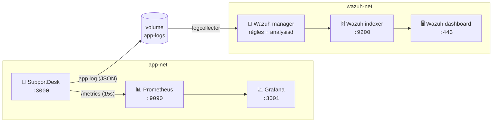

<h1 align="center">🛡️ Sentinel X</h1>

<p align="center">
  <strong>Une application volontairement vulnérable, instrumentée de bout en bout,<br>
  et la chaîne de détection qui la surveille.</strong>
</p>

<p align="center">
  
  
  
  
  
  
  
  
</p>

---

> [!WARNING]
> **SupportDesk est vulnérable par conception** (injection SQL, traversée de chemin, SSRF, mots de passe
> en clair en base). Ce dépôt est un **laboratoire pédagogique**. Ne le déployez jamais sur une machine
> exposée à Internet, et n'exécutez les scénarios d'attaque que contre votre instance locale.

## Sommaire

- [Le projet en deux minutes](#le-projet-en-deux-minutes)
- [Architecture](#architecture)
- [Démarrage rapide](#démarrage-rapide)
- [Accès et comptes de démonstration](#accès-et-comptes-de-démonstration)
- [Observabilité](#observabilité)
- [Détection](#détection)
- [Scénarios d'attaque](#scénarios-dattaque)
- [Tests](#tests)
- [Structure du dépôt](#structure-du-dépôt)
- [Documentation](#documentation)
- [Résultats mesurés](#résultats-mesurés)
- [Limites connues](#limites-connues)
- [Équipe](#équipe)

## Le projet en deux minutes

**SupportDesk** est un gestionnaire de tickets d'assistance interne (Node.js / Express / EJS / SQLite) qui
contient des failles réalistes. Autour de lui, **Sentinel X** construit la chaîne complète d'un SOC miniature :

1. **Instrumenter** — chaque requête produit une ligne de log JSON plate à schéma fermé (14 `event_type`),
   et l'application expose ses métriques au format Prometheus sur `/metrics`.
2. **Détecter** — Wazuh lit ces logs et applique 8 règles personnalisées mappées sur MITRE ATT&CK,
   dont 3 règles de corrélation (brute force, rafale de 5xx, lecture de fichier sensible).
3. **Mesurer** — un générateur de trafic légitime permet de calculer un **taux de faux positifs**,
   et chaque scénario d'attaque est rejouable via un *attack plan* et son *runbook*.

Le contrat technique entre la piste instrumentation et la piste détection est figé dans
**[`CONTRACT.md`](CONTRACT.md)** : format de log, liste fermée des événements, métriques, ports, volumes.

## Architecture



| Flux | Chemin |
|---|---|
| **Détection** | `middleware/logger.js` → `/var/log/supportdesk/app.log` → volume `app-logs` → Wazuh logcollector → décodeur JSON (règle native `86600`) → `local_rules.xml` → `alerts.json` → dashboard |
| **Performance** | `middleware/metrics.js` → `GET /metrics` → scrape Prometheus (15 s) → dashboard Grafana provisionné |

## Démarrage rapide

### Prérequis

| | |
|---|---|
| Docker + Docker Compose | v2 (`docker compose`, sans tiret) |
| RAM disponible | **8 à 12 Go** — l'indexer Wazuh (OpenSearch) réclame ~4 Go de heap à lui seul |
| Ports libres sur l'hôte | `3000`, `3001`, `9090`, `9200`, `443`, `1514`, `1515`, `5140/udp`, `55000` |

### Lancement

```bash
git clone https://github.com/raph-bl/SentinelX.git
cd SentinelX

cp .env.example .env     # puis remplacez tous les "change-me"
docker compose up -d --build
```

> [!NOTE]
> Wazuh met **5 à 15 minutes** à devenir pleinement opérationnel au premier démarrage.
> Suivez la montée en charge avec `docker compose logs -f wazuh.manager`.

Pour ne lancer que l'application sans la stack de supervision :

```bash
docker compose up -d --build supportdesk
```

## Accès et comptes de démonstration

| Service | URL | Identifiants |
|---|---|---|
| SupportDesk | <http://localhost:3000> | voir ci-dessous |
| Grafana | <http://localhost:3001> | `GRAFANA_USER` / `GRAFANA_PASSWORD` du `.env` |
| Prometheus | <http://localhost:9090> | — |
| Wazuh dashboard | <https://localhost> | `INDEXER_USERNAME` / `INDEXER_PASSWORD` du `.env` |

Comptes injectés par `database/seed.js` (mots de passe **stockés en clair**, c'est volontaire) :

| Rôle | E-mail | Mot de passe |
|---|---|---|
| admin | `admin@supportdesk.local` | `Admin_123` |
| admin | `helpdesk@supportdesk.local` | `Help_123` |
| utilisateur | `jdupont@supportdesk.local` *(et 7 autres comptes)* | `User_123` |

## Observabilité

### Logs structurés

Une ligne JSON plate par requête, UTF-8, sans objet imbriqué — directement digeste par le décodeur JSON
de Wazuh. Le schéma complet est décrit dans [`CONTRACT.md` §3](CONTRACT.md).

```json
{"timestamp":"2026-10-20T14:32:11.423Z","level":"WARN","event_type":"auth_failure","source_ip":"203.0.113.42","user":"admin@example.com","endpoint":"/login","method":"POST","status_code":302,"message":"Login failed","body":"{\"email\":\"admin@example.com\",\"password\":\"***\"}","user_agent":"curl/8.5.0"}
```

Règles de capture notables :

- **Liste fermée de 14 `event_type`** (`auth_failure`, `auth_success`, `access_denied`, `ticket_search`, `kb_view`, `server_error`…), un seul par ligne, première règle qui correspond.
- **Les mots de passe sont masqués** (`***`) ; `query` et `body` sont en revanche journalisés **bruts**, sans décodage ni nettoyage, pour que les règles voient les motifs d'attaque.
- `GET /metrics` n'est ni journalisé ni compté, afin de ne pas polluer les mesures avec le bruit du scraping.

### Métriques

`GET /metrics` expose, via `prom-client` :

| Métrique | Type | Labels |
|---|---|---|
| `http_requests_total` | counter | `method`, `route`, `status_code` |
| `http_request_duration_seconds` | histogram | `method`, `route` |
| `app_events_total` | counter | `event_type` |
| `process_*`, `nodejs_*` | — | métriques Node par défaut |

Le label `route` est toujours le **motif** de route (`/tickets/:id`, ou `unmatched`), jamais le chemin réel :
pas d'explosion de cardinalité, et jamais d'IP, d'utilisateur ou de payload en label.

Le dashboard Grafana (requêtes HTTP, tentatives d'authentification, durées) est provisionné automatiquement
depuis `config/grafana/`.

## Détection

8 règles personnalisées dans [`config/wazuh_rules/local_rules.xml`](config/wazuh_rules/local_rules.xml),
toutes chaînées sous la règle native `86600` et mappées sur MITRE ATT&CK.

| ID | Niveau | Déclencheur | MITRE |
|---|:---:|---|---|
| `100000` | 5 | `event_type = auth_failure` *(brique de base)* | T1110 |
| `100001` | 3 | `event_type = server_error` *(brique de base)* | — |
| `100100` | **10** | 8 `auth_failure` en 60 s depuis la même `source_ip` | T1110 |
| `100101` | **12** | `auth_success` dans les 120 s suivant un `100100` | T1110 |
| `100200` | **12** | motif d'injection SQL dans le `body` d'un `ticket_search` | T1190 |
| `100201` | **7** | 6 `server_error` en 60 s depuis la même `source_ip` | T1190 |
| `100300` | **12** | `../`, `..%2f` ou `%2e%2e` dans la `query` | T1083 |
| `100301` | **12** | fichier sensible (`/etc/passwd`, `supportdesk.db`, `seed.js`) via `100300` | T1005 |

> Les règles `100000` et `100001` se déclenchent **par conception** à chaque faute de frappe ou erreur 500.
> L'indicateur de qualité retenu par l'équipe ne compte donc que les alertes de **niveau ≥ 7**.

### Vérifier les règles

```bash
./scripts/wazuh/run_wazuh_tests.sh       # simulation via wazuh-logtest, sans attaque réelle
./scripts/wazuh/run_wazuh_simulation.sh  # vrai trafic d'attaque -> vraies alertes
./check_alerts.sh                        # suit alerts.log en direct
```

## Scénarios d'attaque

Chaque scénario existe en deux documents : un **attack plan** (règles d'engagement, critères de succès,
rédigé avant) et un **runbook** (trace reproductible, rédigé après exécution).

| # | Scénario | Vulnérabilité réelle | Détection | Statut |
|---|---|---|---|---|
| 01 | [Brute force sur `/login`](attack_plans/01-auth-bruteforce.md) | aucune limitation de débit sur l'authentification | `100100` / `100101` | ✅ `100100` confirmée en live |
| 02 | [Injection SQL sur `/tickets/search`](attack_plans/02-sql-injection.md) | concaténation directe dans la clause `LIKE` (`routes/tickets.js`) | `100200` / `100201` | ✅ `100200` confirmée en live |
| 03 | [Traversée de chemin sur `/kb/view`](attack_plans/03-path-traversal.md) | `path.join` sur un paramètre non validé (`routes/kb.js`) | `100300` / `100301` | ✅ `100301` confirmée en live |

Runbooks correspondants : [`runbooks/01`](runbooks/01-auth-bruteforce.md) ·
[`runbooks/02`](runbooks/02-sql-injection.md) · [`runbooks/03`](runbooks/03-path-traversal.md)

### Mesurer les faux positifs

`scripts/traffic/traffic.py` simule des utilisateurs légitimes (connexion → dashboard → tickets →
recherches, commentaires, base de connaissances → déconnexion), avec une IP par utilisateur, une graine
déterministe et un taux configurable de fautes de mot de passe.

```bash
python3 scripts/traffic/traffic.py --duration 600 --users 5 --seed 42 --output run.csv
```

## Tests

Suite fonctionnelle de 8 cas (`node:test` + `supertest`) couvrant les endpoints critiques, **y compris le
contenu des logs émis** : les tests 7 et 8 vérifient qu'un `POST /login` réussi et un `POST /login` échoué —
deux `302` que seul l'en-tête `Location` distingue — sont bien classés en `auth_success` et `auth_failure`.

```bash
./scripts/wazuh/run_tests.sh                            # avec couverture
docker compose run --build --rm supportdesk npm test    # tests seuls
```

> [!IMPORTANT]
> Les tests tournent **dans le conteneur** : `better-sqlite3` est un module natif compilé pour
> `node:20-alpine`, pas pour le Node de l'hôte. Le drapeau `--build` est nécessaire, car
> `docker compose run` ne reconstruit pas l'image et ignorerait vos modifications.

Dernière exécution : **8 tests, 0 échec** — 78,16 % de lignes, 72,45 % de branches, 64,44 % de fonctions.
La couverture est délibérément concentrée sur les composants de sécurité et d'observabilité
(`logger`, `metrics`, `auth` : 84 à 100 % de lignes). Détail dans [`docs/tests.md`](docs/tests.md).

## Structure du dépôt

```
.
├── app.js                      # point d'entrée Express
├── routes/                     # auth · tickets · kb · admin · profile
├── middleware/
│   ├── logger.js               # journalisation JSON + classification des event_type
│   ├── metrics.js              # compteurs et histogrammes Prometheus
│   └── auth.js                 # garde de session et contrôle de rôle
├── database/                   # schéma SQLite et seed
├── views/ · public/            # vues EJS et assets Bootstrap
├── config/
│   ├── wazuh_rules/            # 👈 les 8 règles de détection
│   ├── wazuh_cluster/          # ossec.conf (collecte de app.log)
│   ├── prometheus/ · grafana/  # scrape et dashboards provisionnés
│   └── credentials/            # mots de passe par défaut de la stack Wazuh
├── scripts/
│   ├── wazuh/                  # tests de règles, simulation d'attaque, tests unitaires
│   └── traffic/                # générateur de trafic légitime (mesure des FP)
├── attack_plans/               # plans d'attaque (avant exécution)
├── runbooks/                   # traces reproductibles (après exécution)
├── docs/                       # qualification des alertes, tests
├── tests/                      # suite fonctionnelle
├── CONTRACT.md                 # 👈 contrat technique instrumentation ↔ détection
├── docker-compose.yml          # app + Prometheus + Grafana (inclut wazuh/)
└── wazuh/docker-compose.yml    # manager + indexer + dashboard
```

## Documentation

| Document | Contenu |
|---|---|
| [`CONTRACT.md`](CONTRACT.md) | Contrat technique : schéma de log, `event_type`, métriques, ports, volumes, variables d'environnement |
| [`docs/alert.md`](docs/alert.md) | Rapport de qualification des alertes : protocole, taux de faux positifs, vrais et faux négatifs |
| [`docs/tests.md`](docs/tests.md) | Stratégie de test et taux de couverture détaillé |
| `attack_plans/` · `runbooks/` | Un plan et un runbook par scénario d'attaque |

## Résultats mesurés

Run de référence : **759 requêtes** de trafic normal (600 s, 5 utilisateurs simultanés, graine 42).

| Indicateur | Valeur |
|---|---|
| Taux de faux positifs, alertes de détection (niveau ≥ 7) | **0,00 %** |
| Taux de faux positifs, toutes alertes confondues | 0,53 % (4 alertes `100000` = 4 fautes de mot de passe simulées) |
| Vrais positifs confirmés en live | 3 scénarios sur 3 |

## Limites connues

Elles sont assumées et documentées, pas cachées — le détail est dans [`docs/alert.md`](docs/alert.md) §9.

- **La règle `100200` est trop large.** Son motif accepte `'`, `--` et `order by` isolés : des recherches
  légitimes (`wi-fi -- invité`, `order by date`) déclenchent une alerte de niveau 12. Faux positif confirmé.
- **Un faux négatif est prouvé.** Une injection qui fait planter la requête (`x' union select 1,2,3--`)
  renvoie un 500 : `classify()` la journalise en `server_error` avant d'atteindre la branche `ticket_search`,
  donc `100200` ne la voit jamais. Correctif de fond : paramétrer la requête SQL dans `routes/tickets.js`.
- **`source_ip` est falsifiable.** L'en-tête `X-Forwarded-For` est de confiance (`trust proxy`), ce qui
  permet la rotation d'IP pour contourner les règles de corrélation.
- **Le 0 % de faux positifs n'est pas représentatif** : trafic synthétique, 6 termes de recherche sans
  caractère spécial, fenêtre de 10 minutes, une seule graine.
- **Aucune règle n'a encore été corrigée** : il n'y a donc pas de mesure avant/après.

## Équipe

Projet Epitech **B-SPE-322 — Sentinel X** (`MPL-3-1`) · Tara-Nour Monteiro · Flauréanne Soldat · Raphaël Bertaina-Loichemol

| Piste | Responsable |
|---|---|
| Détection (Wazuh, règles) | Tara-Nour Monteiro |
| Monitoring (Prometheus, Grafana, Docker Compose) | Flauréanne Soldat |
| Instrumentation (logs, `/metrics`) | Raphaël Bertaina-Loichemol |
